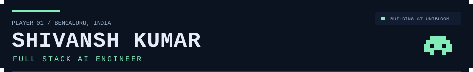

  
  

<strong>I build AI applications, search systems, and the backends that bring them to life.</strong> TypeScript · Python · SQL · Production AI

  
  
  
  

<a href="resume/Shivansh-Kumar-Resume.pdf">View resume</a> · <a href="#journey">Experience</a> · <a href="https://github.com/Shivansh-Kumar-007?tab=repositories">Repositories</a>

## Character sheet

I'm **Shivansh**, a Full Stack AI Engineer based in **Bengaluru, India**. At **Unibloom**, I work across web applications, AI services, retrieval pipelines, and carbon emissions forecasting.

I enjoy making systems faster, making data easier to find, and taking ideas through to production. Outside the editor: **pixel games and animation**.

<strong>▶ Open my current quest</strong>

My work connects the product experience to the services underneath it:

- Build web applications and AI services with **Next.js, TypeScript, and Bun**.
- Design **RAG and tool-calling workflows** backed by PostgreSQL and pgvector.
- Serve forecasting models through **FastAPI on Google Cloud Run**.
- Ship with **GitHub Actions**, and tune deployments for performance and cost.

**My approach:** understand the data, measure the bottleneck, and build something useful.

## Missions

**Select a project to open its build notes.**

<strong>▶ 01 · Unibloom LCA — Carbon emissions forecasting</strong>

### From sustainability data to production predictions

Built forecasting services with **XGBoost, LightGBM, and FastAPI**, deployed on **Google Cloud Run**.

| Build | Result |
| :--- | :--- |
| Model development and validation | **15% lower RMSE**, assessed with out-of-sample holdout data against historical baselines |
| Data ingestion | Python workflows using Crawl4AI and Tinyfish Search |
| Inference infrastructure | CPU, memory, and autoscaling tuned for performance and compute costs |
| Delivery | Automated deployment through GitHub Actions |

**Loadout:** `Python` `XGBoost` `LightGBM` `FastAPI` `Cloud Run`

[Explore Unibloom ↗](https://www.unibloom.world)

<strong>▶ 02 · Unibloom Switch — Retrieval and AI workflows</strong>

### Making sustainability data easier to find and use

Designed **retrieval-augmented generation and tool-calling workflows** for AI agents that provide sustainability recommendations.

- Built semantic search with **PostgreSQL and pgvector**.
- Optimized a hybrid retrieval pipeline, reducing retrieval latency by **50%**.
- Reduced backend latency and context-window bottlenecks in agent workflows.
- Developed web and AI services with **Next.js and Bun**.

**Loadout:** `TypeScript` `Next.js` `Bun` `PostgreSQL` `pgvector` `RAG`

[Explore Unibloom ↗](https://www.unibloom.world)

<strong>▶ 03 · Production engineering — Beyond the AI layer</strong>

### The systems that keep a product running

At **Unibloom**, I integrated Stripe for one-time purchases and recurring subscriptions, including error handling for payment processing. Migrating the AI runtime also reduced cold-start latency by **30%**.

Previously, at **Argenbright Innovation Lab**, I worked on a distributed ecosystem of **40+ Node.js and NestJS microservices**:

- Used **k6 load testing** to identify database bottlenecks.
- Optimized MySQL and PostgreSQL queries, reducing latency by **40%** across high-traffic endpoints.
- Built REST and GraphQL APIs supporting **12,000+ concurrent users**, with **99.9% uptime** for core business services.
- Applied **Domain-Driven Design** to improve maintainability and reduce feature delivery cycles by **30%**.

**Loadout:** `Node.js` `NestJS` `SQL` `REST` `GraphQL` `k6` `Stripe`

## Inventory

**Open a compartment to see the tools inside.**

<strong>⌨ Languages & application development</strong>

| Slot | Tools |
| :--- | :--- |
| Languages | TypeScript · Python · SQL · Go |
| Web | Next.js · Node.js · Bun · NestJS |
| APIs | FastAPI · REST · GraphQL |
| Architecture | Microservices · Domain-Driven Design |

<strong>✦ AI, retrieval & machine learning</strong>

| Slot | Tools & techniques |
| :--- | :--- |
| AI applications | RAG · AI agents · Tool calling |
| Retrieval | Embeddings · Semantic search · pgvector |
| Models | XGBoost · LightGBM · TabPFN |
| Libraries | Scikit-learn · PyTorch |

<strong>▣ Data, cloud & delivery</strong>

| Slot | Tools |
| :--- | :--- |
| Data | PostgreSQL · MySQL · Prisma · Data ingestion pipelines |
| Cloud | GCP · Cloud Run · AWS |
| Platforms | Vercel · Supabase |
| Delivery | GitHub Actions · CI/CD |

## Journey

| Chapter | Role | Location |
| :--- | :--- | :--- |
| Jun 2025 – Present | **Full Stack AI Engineer · Unibloom** | Sweden / Remote |
| Sep 2022 – Mar 2025 | **Software Engineer · Argenbright Innovation Lab** | Bengaluru |
| 2022 | **B.E. · Computer Science & Engineering** | Sri Sairam College of Engineering |

## Resume & contact

Have an interesting AI product, a search problem, or a backend challenge? **[Let's talk](mailto:shivanshkumar994@gmail.com).**

  

**[View resume](resume/Shivansh-Kumar-Resume.pdf)** · **[Email](mailto:shivanshkumar994@gmail.com)** · **[Repositories](https://github.com/Shivansh-Kumar-007?tab=repositories)**

